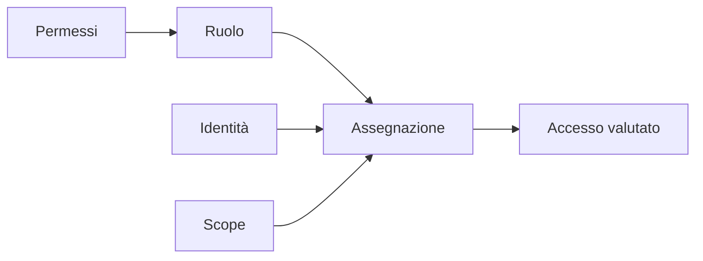

# Concetti — Identità, accessi, sicurezza, governance e costi

## 1. Identità prima della risorsa

Un servizio cloud deve stabilire **chi** sta effettuando una richiesta e **che cosa** quell'identità può fare. L'autenticazione verifica l'identità; l'autorizzazione valuta l'azione richiesta su una risorsa e in uno scope determinato.

Accedere correttamente al portale non implica poter creare, modificare o eliminare qualunque risorsa. Nel lavoro reale molti incidenti di accesso nascono proprio dalla confusione tra accesso riuscito e permesso effettivo.

Microsoft Entra ID è il servizio di gestione delle identità e degli accessi usato da Azure. Il tenant contiene oggetti come utenti, gruppi, applicazioni e identità dei carichi di lavoro. La sottoscrizione Azure è associata a un tenant, ma tenant e sottoscrizione non sono lo stesso confine.

## 2. Utenti, gruppi e identità dei carichi di lavoro

Un utente rappresenta normalmente una persona. Un gruppo raccoglie identità per gestirne l'accesso in modo coerente. Assegnare un ruolo a un gruppo è più manutenibile che ripetere la stessa assegnazione per molte persone: ingresso e uscita dal gruppo modificano l'accesso senza ricreare ogni assegnazione.

Un'applicazione o un processo automatico non dovrebbe utilizzare l'account personale di un operatore. In seguito incontreremo service principal, managed identity e workload identity federation. Qui è sufficiente distinguere identità umane e identità dei carichi di lavoro.

Microsoft descrive l'uso dei gruppi per applicare accessi comuni nella [panoramica sui gruppi Microsoft Entra](https://learn.microsoft.com/entra/fundamentals/concept-learn-about-groups).

## 3. Ruoli Microsoft Entra e ruoli Azure

I ruoli Microsoft Entra autorizzano la gestione degli oggetti della directory: utenti, gruppi, domini e configurazioni del tenant. Un **User Administrator**, per esempio, opera sulle identità entro i limiti del ruolo.

I ruoli Azure autorizzano operazioni sulle risorse Azure tramite Azure Resource Manager. **Reader**, **Contributor** e **Owner** sono esempi di ruoli Azure.

| Esigenza | Sistema di autorizzazione |
|---|---|
| Creare un utente nel tenant | Ruolo Microsoft Entra appropriato |
| Leggere una VNet | Azure RBAC |
| Modificare un resource group | Azure RBAC |
| Gestire l'appartenenza a un gruppo | Ruolo/permesso Microsoft Entra appropriato |
| Assegnare un ruolo Azure | Azure RBAC con permesso `roleAssignments/write` |

Essere Global Administrator non rende automaticamente Owner di tutte le sottoscrizioni. Allo stesso modo, essere Owner di una sottoscrizione non concede automaticamente la gestione completa degli utenti del tenant.

## 4. Il modello Azure RBAC: permesso, ruolo e assegnazione

Per capire come funziona Azure RBAC è utile partire da un'operazione molto semplice: **consultare una rete virtuale**. Azure rappresenta questa possibilità con un'azione specifica, ad esempio `Microsoft.Network/virtualNetworks/read`. Questa azione è un **permesso**: descrive *che cosa* si può fare, ma da sola non dice *chi* possa farlo né *dove*.

Un **ruolo** (role definition) riunisce invece più permessi in un insieme riutilizzabile. Il ruolo **Reader**, ad esempio, raccoglie le azioni necessarie per consultare le risorse Azure senza gestirle. Il ruolo **Contributor** permette molte operazioni di gestione, ma non consente normalmente di assegnare ruoli ad altre identità. Un ruolo, quindi, non coincide con un singolo permesso: **è una definizione che comprende una o più operazioni autorizzate**.

Infine, anche se un ruolo esiste, nessuno riceve automaticamente quei permessi. Serve un'**assegnazione di ruolo** (*role assignment*), che collega il ruolo a un'identità e ne circoscrive l'applicazione.



**Come leggere lo schema.** I permessi descrivono singole operazioni, il ruolo le raccoglie. Soltanto quando il ruolo viene assegnato a un'identità su uno scope quell'identità può usare quei permessi in quell'ambito, nei limiti delle altre regole di accesso applicabili. Il controllo avviene quando l'identità tenta l'operazione.

Un'assegnazione di ruolo collega quindi tre elementi:

```text
principal + role definition + scope = role assignment
```

- Il **principal** è l'identità: utente, gruppo, service principal o managed identity.
- La **role definition** è il modello di autorizzazioni, cioè l'insieme delle azioni che caratterizza il ruolo.
- Lo **scope** stabilisce il confine in cui quel modello viene assegnato all'identità.

**Esempio completo.** Supponiamo che Martina debba leggere le risorse del progetto `rg-formazione`, senza modificarle. La singola operazione di lettura è un permesso; **Reader** è un ruolo che comprende permessi di lettura; assegnare **Reader a Martina sul resource group `rg-formazione`** è la *role assignment*. Creare o selezionare Reader senza effettuare l'assegnazione non concederebbe nuovi accessi a Martina.

Gli scope principali, dal più ampio al più specifico, sono **management group → sottoscrizione → resource group → risorsa**. Un'assegnazione al livello superiore viene normalmente ereditata dai livelli inferiori. La [documentazione sugli scope RBAC](https://learn.microsoft.com/azure/role-based-access-control/scope-overview) mostra questa gerarchia.

Assegnare Contributor alla sottoscrizione quando basta Reader su un resource group aumenta inutilmente l'impatto di un errore o di una compromissione. Per questo, oltre a scegliere il ruolo minimo, bisogna assegnarlo **allo scope minimo necessario**.

## 5. Ruoli fondamentali

| Ruolo | Può leggere | Può modificare risorse | Può assegnare ruoli |
|---|:---:|:---:|:---:|
| Reader | sì | no | no |
| Contributor | sì | sì | no |
| Role Based Access Control Administrator | accesso necessario alla gestione RBAC | non è un ruolo generale di gestione risorse | sì, nei limiti previsti |
| Owner | sì | sì | sì |

Questa tabella è una sintesi: in un caso reale si controlla sempre la definizione effettiva del ruolo. Una role definition e una role assignment sono oggetti diversi: la prima descrive permessi riutilizzabili, la seconda li collega a un principal e a uno scope.

### Come si definisce un ruolo

Azure mette a disposizione numerosi **ruoli predefiniti** (*built-in roles*), come Reader, Contributor e Owner: le relative definizioni sono fornite e mantenute da Microsoft. Quando nessuno di questi risponde al bisogno reale, un'organizzazione può creare un **ruolo personalizzato** (*custom role*) scegliendo un insieme più circoscritto di azioni.

Una role definition contiene principalmente questi elementi:

| Elemento della definizione | A cosa serve |
|---|---|
| **Nome e descrizione** | Rendono riconoscibile lo scopo del ruolo. |
| `Actions` | Operazioni consentite sul **piano di gestione** (*control plane*), per esempio leggere una VM o avviarla. |
| `NotActions` | Operazioni escluse da quelle specificate in `Actions` per **quel ruolo**. Non sono un divieto assoluto: un altro ruolo assegnato può consentire la stessa azione. |
| `DataActions` e `NotDataActions` | Permessi ed esclusioni sul **piano dati** (*data plane*), per esempio leggere il contenuto dei blob. |
| `AssignableScopes` | Ambiti nei quali la **definizione del ruolo può essere assegnata**; non equivale allo scope di una singola assegnazione e non concede accesso da solo. |

Si immagini un tecnico che debba **consultare e avviare** alcune VM di laboratorio, ma non eliminarle né modificare l'intera sottoscrizione. Un ruolo personalizzato potrebbe includere, fra le azioni necessarie, `Microsoft.Compute/virtualMachines/read` e `Microsoft.Compute/virtualMachines/start/action`, con gli eventuali ulteriori permessi strettamente necessari al caso concreto. Una volta definito, quel ruolo potrebbe essere assegnato al tecnico soltanto sulle risorse pertinenti. **Questo è un esempio concettuale**, non una definizione completa pronta per la produzione: i permessi effettivi vanno verificati nel servizio e nel contesto d'uso.

La distinzione fra **definire** e **assegnare** è anche tecnica: creare o aggiornare un ruolo personalizzato richiede l'autorizzazione `Microsoft.Authorization/roleDefinitions/write`; assegnarlo a un'identità richiede `Microsoft.Authorization/roleAssignments/write`. Si tratta di capacità amministrative distinte. Nel laboratorio di oggi useremo Reader, senza creare nuovi ruoli personalizzati.

**Da discutere in aula.** Se un amministratore crea il ruolo personalizzato «Lettore reti», un partecipante può subito leggere le VNet? **No:** occorre assegnare quel ruolo all'identità sullo scope appropriato, e verificare l'accesso effettivo. Se il ruolo contiene dieci azioni, rappresenta dieci permessi distinti raggruppati in una definizione, non un unico permesso.

Per approfondire: [definizioni dei ruoli Azure](https://learn.microsoft.com/it-it/azure/role-based-access-control/role-definitions) e [ruoli personalizzati](https://learn.microsoft.com/it-it/azure/role-based-access-control/custom-roles).

## 6. Ereditarietà e accesso effettivo

Un utente può ricevere autorizzazioni da più assegnazioni dirette e di gruppo. Un ruolo visto su una risorsa può provenire dalla sottoscrizione o dal resource group. Per diagnosticare un accesso bisogna quindi chiedersi:

1. quale identità sta operando;
2. in quale tenant e sottoscrizione;
3. quale azione è stata negata;
4. su quale scope;
5. quali assegnazioni dirette, di gruppo o ereditate sono applicabili;
6. se l'assegnazione è recente e deve ancora propagarsi.

Non si risolve un `AuthorizationFailed` assegnando automaticamente Owner: prima si individua l'azione necessaria e lo scope minimo.

## 7. Zero Trust e minimo privilegio

Zero Trust non significa “non fidarsi delle persone”. Significa non considerare affidabile una richiesta soltanto perché proviene da una rete interna o da un accesso già avvenuto. Il modello richiede verifica esplicita, accesso minimo necessario e assunzione della possibilità di compromissione.

Il minimo privilegio riduce:

- il numero di operazioni possibili per errore;
- l'impatto di credenziali compromesse;
- la difficoltà di audit;
- la superficie amministrativa permanente.

## 8. Governance: tag, lock e policy

I tag descrivono risorse e costi, ma non autorizzano né impediscono operazioni. Un lock protegge uno scope da eliminazione (`CanNotDelete`) o da modifiche (`ReadOnly`). Un lock non sostituisce RBAC: RBAC decide chi può richiedere operazioni, il lock aggiunge una protezione gestionale applicabile anche a utenti autorizzati.

I lock vengono ereditati dalle risorse figlie. Prima di eliminare un resource group occorre rimuovere i lock applicabili. La [guida Microsoft sui resource lock](https://learn.microsoft.com/azure/azure-resource-manager/management/lock-resources) descrive effetti e limitazioni.

Azure Policy valuta o impone regole organizzative, per esempio località consentite o presenza di tag. In questa unità ne osserviamo il ruolo concettuale; la creazione di policy personalizzate non è necessaria per comprendere il confine tra accesso e conformità.

## 9. Cost Management, costo e budget

Cost Analysis permette di osservare spesa e tendenze allo scope disponibile. I dati non sono necessariamente immediati: una risorsa appena creata può non comparire subito.

Un budget confronta la spesa osservata con una soglia e può generare notifiche. **Non blocca automaticamente la spesa e non spegne le risorse.** Un alert di budget è un segnale per persone o automazioni; non è un limite di consumo.

La disponibilità di viste, previsioni e budget dipende dal tipo di sottoscrizione e dai permessi. La [guida ai budget](https://learn.microsoft.com/azure/cost-management-billing/costs/tutorial-acm-create-budgets) e la [panoramica di Cost Analysis](https://learn.microsoft.com/azure/cost-management-billing/costs/quick-acm-cost-analysis) sono i riferimenti operativi.

⏱

## 10. Domande di controllo

Inserisci le risposte motivate in `consegne/UD03/00_DOMANDE_CONCETTI.md`.

1. Perché autenticazione riuscita e autorizzazione sufficiente non sono equivalenti?
2. Quale differenza operativa esiste tra ruolo Microsoft Entra e ruolo Azure?
3. Quali tre elementi formano una role assignment?
4. Perché Reader su un resource group è preferibile a Contributor sulla sottoscrizione quando serve soltanto consultare quel progetto?
5. Perché un ruolo ereditato non si rimuove dalla risorsa figlia?
6. Un tag `deleteAfter` impedisce l'eliminazione? Motiva.
7. Che cosa cambia tra lock `CanNotDelete` e ruolo Reader?
8. Perché un budget non è sufficiente a garantire che la spesa non superi una cifra?

⏱
